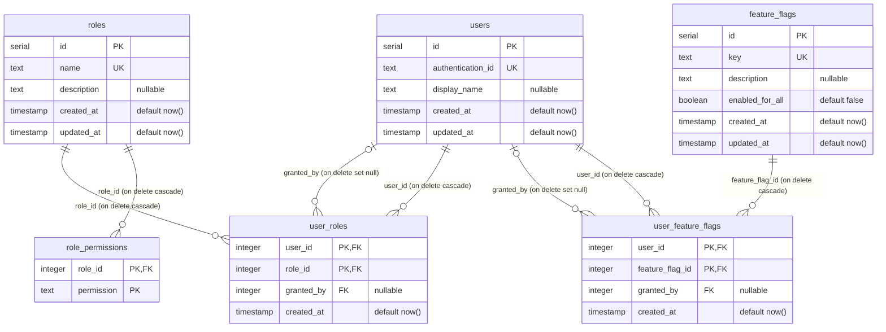

# Database ERD

<!-- Generated from src/db/schema.ts by `pnpm --filter @books/database run db:erd`. Do not edit by hand. -->

Tables of the `books` PostgreSQL schema. `PK` primary key, `FK` foreign key, `UK` unique.

